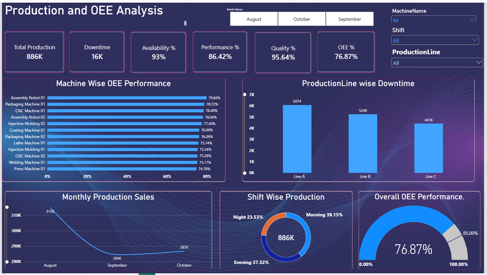
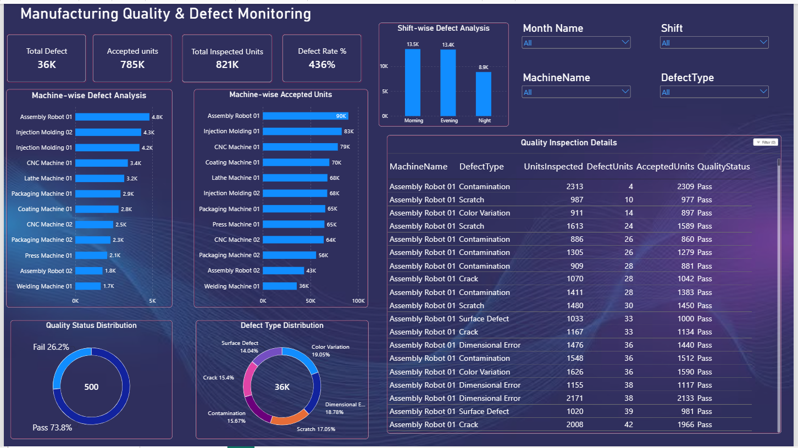

# Manufacturing OEE & Quality Analytics

##  Project Overview
Manufacturing OEE & Quality Analytics is a Power BI project designed to analyze production efficiency, machine performance, downtime, and product quality.

This project helps understand manufacturing performance using interactive dashboards and data visualization.

##  Project Objectives
- Analyze overall equipment effectiveness (OEE).
- Monitor machine-wise production performance.
- Identify production downtime.
- Analyze defects and accepted units.
- Compare quality performance across shifts.
- Track monthly production trends.

##  Tools & Technologies
- Power BI
- Power Query
- DAX
- CSV Datasets

##  Datasets
This project uses three datasets:

1. **production.csv** – Production details, dates, machines, shifts, downtime and total units produced.
2. **machines.csv** – Machine names, machine types, production lines and efficiency targets.
3. **quality.csv** – Inspection details, defect units, accepted units and quality status.

##  Data Cleaning
Data cleaning and transformation were performed using Power Query.

- Checked missing values.
- Checked duplicate records.
- Verified column data types.
- Checked data consistency.

##  Data Modeling
Relationships were created between the three tables:

- Machines → Production (MachineID)
- Production → Quality (ProductionID)

##  DAX Measures
The following measures were created:
- Total Production
- Total Downtime
- Total Defects
- Total Accepted Units
- Availability %
- Performance %
- Quality %
- OEE %
- Defect Rate %

##  Dashboard and details

### 1. Production & OEE Analysis
- Total Production
- Total Downtime
- Availability %
- Performance %
- Quality %
- OEE %
- Machine-wise OEE
- Monthly Production Trend
- Shift-wise Production
- Production Line-wise Downtime
- OEE Gauge Chart

### 2. Mnufacturing quality and Defect Monitoring
- Total Defects
- Total Accepted Units
- Total Inspected Units
- Defect Rate %
- Defect Type Distribution
- Machine-wise Defect Analysis
- Shift-wise Defect Analysis
- Quality Status Distribution
- Machine-wise Accepted Units
- Quality Inspection Details

##  Project Outcome
This project provides insights into manufacturing efficiency, machine performance, production downtime and product quality through interactive Power BI dashboards.

##  Conclusion

The Manufacturing OEE & Quality Analytics project helped analyze manufacturing performance using Power BI. It provides insights into overall equipment effectiveness (OEE), machine-wise production, downtime, and product quality.

Through interactive dashboards, users can identify production trends, monitor machine efficiency, analyze defects, and compare quality performance across different shifts.

Overall, this project demonstrates how data analytics and visualization can support better decision-making and improve manufacturing performance.
